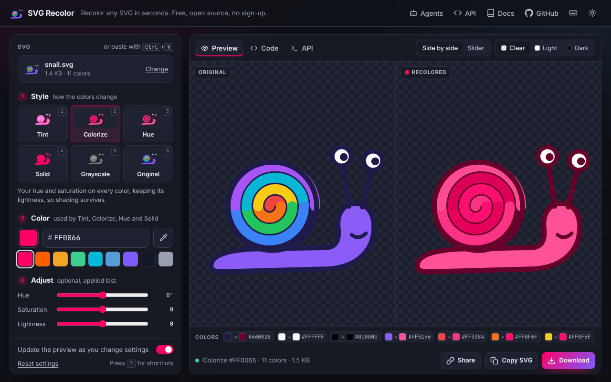
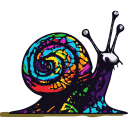
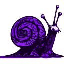

# SVG Recolor

[](https://github.com/Snailedlt/svg-recolor/blob/main/LICENSE)
[](https://wakatime.com/badge/github/Snailedlt/svg-recolor)
[](https://ko-fi.com/snailedlt)
[](https://buymeacoffee.com/snailedlt)

[](https://github.com/Snailedlt/svg-recolor/actions/workflows/ci.yml)
[](https://github.com/Snailedlt/svg-recolor/actions/workflows/uptime.yml)

SVG Recolor is a website, HTTP API, MCP server and CLI to recolor SVG files. It is written in Python.



> [!NOTE]
> Submodules have their own licenses and may or may not be covered by the license of this project. Check the submodule's license for details.

## Features

- [Website](#website): recolor SVGs in the browser, no setup, with code for 24 frameworks.
- [API](#api): the same over HTTP, plus an [MCP server](#ai-agents) for AI agents.
- [CLI Tool](#cli-tool): recolor files from your terminal, with Python or the [shell script](#shell-script).

## Usage

### Website

The website is hosted at [svg-recolor.jorgenkh.no](https://svg-recolor.jorgenkh.no) and requires no installation.

### Modes

| Mode | What it does | Powered by |
| --- | --- | --- |
| `tint` (default) | Grayscale, then add the color. Dark areas take the color, highlights stay light. | svgray + `svgshift addrgb` |
| `colorize` | Set hue and saturation to the color, keep each shade's lightness. | `svgshift sethsl H S x` |
| `hue` | Set only the hue. | `svgshift sethsl H x x` |
| `solid` | Replace every color with the target color. | `svgshift setrgb R G B` |
| `grayscale` | Convert to grayscale. | svgray |
| `adjust` | Keep the colors, only apply the fine-tuning below. | `svgshift addhsl/subhsl` |

Every mode can be fine-tuned with `hue` (rotate, -360..360 degrees), `saturation` and `lightness` (-100..100).

### Per-color edits

On top of any mode, single colors (the original ones, as listed by `/api/palette`) can be edited:

| Edit | API | What it does |
| --- | --- | --- |
| Own color | `replace=5e97f6:ff0000,...` | That color gets its own new color instead of the mode's. |
| Hide | `hide=ffffff,...` | The color becomes `none` (fill/stroke) or `transparent` (gradient stops); the shapes stay in the file. |
| Remove | `remove=ffffff,...` | Shapes painted with the color are deleted, including ones that inherit it from a group or a CSS class. A shape keeps its fill or stroke when only the other is removed. Shapes inside `<defs>`, `<clipPath>`, `<mask>` and similar are only hidden, never deleted. |

A one-color icon, like a devicon `plain` version, is `mode=solid&color=000000&holes=light` (Solid, and white or
near-white parts become holes; in the editor, **Light colors become holes** under Color). `remove=ffffff` instead
just drops a white background.

Three more edits need path geometry. The editor runs them in the browser, and the API and MCP server run the very
same code (paper.js and SVGO in QuickJS, with picosvg reading the shapes), so the results match:

- **Cut out** (a color's option in the color panel; API `cut=dce0df`): the color becomes a real gap. Only the part you can see in the
  original is cut, and the result is flattened to one path per color. For logos with outlines between their parts
  (like JAX), Solid + Cut out on the outline gives a one-path plain version with gaps exactly where the outlines were.
- **Gaps** (API `gap=2`; slider under Adjust, in px of the SVG's own units, or % of the icon): every boundary between two original colors gets a
  gap of that width; the outer edge stays put. For logos whose parts just touch (like rqlite), Solid + Gaps keeps the
  parts apart in one color.

- **Line** (API `line=3`, `lines=outer`, `keep=ffffff`; slider under Adjust, same units): a line version, like devicon's `line` icons. Only a band of that width
  along the edges is kept: inside the outer edge, and centered on the boundaries between colors (switch off **Lines
  between colors** for just the outline). In the color panel, **Keep filled** keeps a color solid, for small details.

**Canvas** (the viewBox size is on the picture; the rest is under **Placement**; API: `canvas=128x128`, `place=x,y,scale`, `fit=1`): set the canvas size, the drawing's size and position, or
**Fit to canvas** with a padding: the visible drawing (strokes included, invisible colors not) is scaled and centered
so it ends exactly that far from every edge. Fit stays on: the next SVG, or a new canvas size, is fitted too (moving or
resizing by hand turns it off). For devicon: canvas 128 × 128, padding 1, Fit. The drawing is wrapped in one
`<g transform>`, so every other feature works on top.

On the API these get 20 seconds per request: most icons take well under a second, but very complex drawings
(thousands of curves) may need the editor, which runs them in your browser without a limit.

All three work on flat colors and shapes. When everything ends up one color (like Solid), gradients and transparency
don't matter: such paints take that color, while each gradient still counts as its own part for gaps and lines, and
mostly see-through shapes (shadows, glows) are left out. In the editor, text is turned into shapes (with a font file you choose under
**Shapes**, or Inter when none is chosen); the API asks for text as paths. Embedded images, masks, `<use>` and, with
several colors, gradients and transparency get a clear message instead of a guess.

In the editor, click a color in the **Colors** strip under the preview, or click the shape itself in the picture, to edit it.
Each chip shows a small badge for what its color does (own color, invisible, cut out, kept filled), and **Reset colors**
puts every color back to following the style.

Before recoloring, colors are normalized so the tools can handle them: CSS color names, `rgb()`/`hsl()`
(with alpha), and 3/4-digit hex are converted to hex, and icons that rely on the default black fill
(or `currentColor`) get an explicit black so they recolor too. `url(#id)` and `href="#id"` references are left alone.

Colors can be given as `ff0066`, `#ff0066`, `f06`, `255,0,102`, `rgb(255 0 102)`, `hsl(330 100% 50%)` or a CSS name like `tomato`.

### API

The API is hosted at the same URL as the website. Interactive docs: [Swagger](https://svg-recolor.jorgenkh.no/docs) or [ReDoc](https://svg-recolor.jorgenkh.no/redoc).

| Endpoint | Description |
| --- | --- |
| `GET /api/recolor?url=…` | Recolor an SVG from a public link (GitHub file pages are converted to raw links). Cacheable, so it works as an ``. |
| `POST /api/recolor` | Recolor an SVG sent as a multipart `file` field, a multipart `url` field, or the raw request body. |
| `POST /api/recolor/batch` | Recolor up to 50 files (`files` fields) with the same settings and get a ZIP back. |
| `GET /api/palette?url=…` / `POST /api/palette` | List the colors in an SVG with their counts. |
| `GET /api/modes` | List the modes and option ranges. |
| `POST /colorize` | Original endpoint, kept for backwards compatibility. |

Query parameters for the recolor endpoints: `color`, `mode`, `hue`, `saturation`, `lightness`,
`format` (`svg` or `json`, which also returns the old→new color mapping) and `download`.

```sh
# Upload a file
curl -X POST "https://svg-recolor.jorgenkh.no/api/recolor?color=ff0066&mode=colorize" \
  -F "file=@icon.svg" -o icon-pink.svg

# Send the SVG as the request body
curl -X POST "https://svg-recolor.jorgenkh.no/api/recolor?color=tomato&mode=solid" \
  -H "Content-Type: image/svg+xml" --data-binary @icon.svg -o icon-red.svg

# Recolor from a link
curl "https://svg-recolor.jorgenkh.no/api/recolor?url=https://example.com/icon.svg&mode=hue&color=teal" -o icon.svg

# Many files at once
curl -X POST "https://svg-recolor.jorgenkh.no/api/recolor/batch?mode=grayscale" \
  -F "files=@a.svg" -F "files=@b.svg" -o recolored.zip
```

```html
<!-- Use it directly as an image -->

```

The `POST` endpoints also accept JSON, which is the easiest format for scripts and agents:

```sh
curl -X POST "https://svg-recolor.jorgenkh.no/api/recolor?format=json" \
  -H "Content-Type: application/json" \
  -d '{"svg": "<svg xmlns=\"http://www.w3.org/2000/svg\"><circle r=\"4\"/></svg>", "color": "tomato", "mode": "solid"}'
```

### AI agents

- **MCP server** (streamable HTTP, no auth) at `/mcp` with the tools `recolor_svg`, `list_svg_colors` and `list_recolor_modes`:

  ```sh
  claude mcp add --transport http svg-recolor https://svg-recolor.jorgenkh.no/mcp
  ```

- **[`/llms.txt`](https://svg-recolor.jorgenkh.no/llms.txt)**: a plain-text guide to the endpoints, parameters and modes.
- **[`/api`](https://svg-recolor.jorgenkh.no/api)**: a JSON index of the endpoints. The [OpenAPI spec](https://svg-recolor.jorgenkh.no/openapi.json) has stable operation IDs (`recolorSvg`, `recolorFromUrl`, ...).

### Recolor just colors

`GET /api/map-colors?colors=5a9fd4,306998&color=tomato&mode=colorize` returns `{"mapping": {"#5a9fd4": "#…"}}`.
Useful for design tokens and themes. It is also what the website uses: the browser extracts the SVG's
palette, asks this endpoint for the new colors, and applies them locally, so the SVG itself is never uploaded.

### Hosting and scaling

Built to stay inside a free hosting tier. What a visitor costs:

| | Requests | Function calls |
| --- | --- | --- |
| First visit | 6 (page, CSS, one script bundle, 2 fonts, favicon) | 1 (the page, then cached at the CDN) |
| Repeat visit | 0 (everything is cached in the browser) | 0 |
| Loading an SVG | 1 API call | at most 1 (identical palettes are CDN hits) |
| Each color or adjustment change | 1 API call | at most 1 |
| Switching style | 0 | 0 |

How:

- **Only the palette goes to the server.** The browser extracts the SVG's colors and calls `GET /api/map-colors`
  once with `modes=` for all six styles, which feeds both the preview and the style thumbnails. With `v=<engine version>`
  the response is cacheable for a year, so the CDN answers repeat palettes without running the function.
  The output is byte-for-byte the same as `POST /api/recolor`.
- **The page ships what it needs.** The sample image's colors for the default settings are embedded in the page (no API
  calls on load), the scripts are served as one bundle (`/assets/app.js`), and small images are inlined.
- **Everything versioned is immutable.** CSS, the bundle, fonts and icons carry a content hash or version in their URL and
  are cached for a year; the page itself for 5 minutes in the browser and a day at the CDN (Vercel purges on deploy).
- **No wasted invocations.** `/favicon.ico`, `/apple-touch-icon.png` and `/robots.txt` are answered and cached instead of
  404ing through the function, and `robots.txt` keeps crawlers off the API.
- Results are cached per color and setting inside each warm instance, and the per-IP rate limiter caps abuse
  (see Configuration).
- Bump `ENGINE_VERSION` in `recolor.py` whenever the color math changes, so cached mappings are not reused.

### Website tips

- The page URL keeps your settings and color edits (`?mode=colorize&color=ff0066&remove=ffffff&url=...`), so you can bookmark a setup. Opening a link with `url=` loads that SVG.
- **Paste** (Ctrl+V) takes an `.svg` file copied in the file manager, SVG code, an SVG copied from a web page, a link, or
  the result of a browser's **Copy image** on an SVG (the browser copies a PNG, plus the image's address, which is used to get the SVG itself).
- **Optimize** (API `optimize=true`, `precision=3`) runs SVGO 3.3.2, with devicon's settings by default (precision 3, multipass,
  every preset plugin but removeViewBox, devicon's extra plugins, a newline at the end): the same bytes as devicon's
  svg-icons `optimize.js`. Every plugin can be switched; the settings are saved in your browser.
- **With code** (next to Side by side and Slider) shows the result's SVG code beside the picture; **Small sizes** shows
  the result at 16, 32 and 64 px on light and dark.
- **Batch**: choose, drop or paste several SVGs. The first opens to tune the settings, a bar lists them all, and
  **Download all** recolors each one the same way (Fit per file) into a ZIP. Files that fail are named; the rest go in.
- **Recipes** (by Reset settings): save the current settings under a name and apply them to other SVGs later, or copy
  a recipe's link. They keep style, color, adjustments, shapes, canvas, Fit and Optimize, not the edits of single colors.
  A recipe's link carries its name (`recipe=`), shown at the top of the settings with a button to save it; add
  `url=` to open an SVG with it.
- **Undo / redo** settings changes with the buttons by Reset settings, or <kbd>Ctrl</kbd>+<kbd>Z</kbd> /
  <kbd>Ctrl</kbd>+<kbd>Shift</kbd>+<kbd>Z</kbd>.
- **Share** copies a link with your SVG and settings. A linked SVG is shared by its address; a pasted or uploaded one travels in the link itself, compressed, after the `#` (never sent to the server). Very large SVGs don't fit in a link: share them from a public URL instead.
- Everything fits on one screen: settings on the left, and Preview, Code and API tabs on the right, with Share, Copy and Download always visible.
- Settings follow the order the engine applies them: **1 Style** (each tile shows your SVG in that style), **2 Color** (only for
  styles that use one) and **3 Adjust** (hue, saturation and lightness, applied last to any style). The "Original" style keeps
  the colors so only Adjust changes them (`mode=adjust` in the API).
- The **Code** tab lists every format beside the code and turns the result into ready-to-paste code for 23 targets, and Download saves it with the right file name:
  - Basics: SVG, HTML ``, CSS, Tailwind, data URI, Base64, Markdown
  - JavaScript: React, React (TS), React Native, Vue, Svelte, Angular, Solid, Astro, Lit, Web Component
  - Python: Python, Streamlit, Django / Jinja
  - More: Laravel Blade, Flutter, Blazor

- The **API** tab turns your settings into a ready-to-run request in 21 languages and clients: curl, HTTPie, PowerShell,
  a hotlink URL, HTML, Markdown (for READMEs), fetch, Node.js, axios, Python requests and httpx, Go, Rust, Java, Kotlin, C#, PHP, Ruby, Swift,
  Dart, plus MCP setup.
- Need something else? Pick **AI prompt** in either tab (or search for your language) and type a language or framework.
  You get a prompt to paste into ChatGPT, Claude, Copilot or any AI agent: for the Code tab it includes the recolored SVG,
  for the API tab it describes the endpoint, settings, responses and errors.

  Press <kbd>F</kbd> to search formats or languages. Code formats live in [`static/formats.js`](static/formats.js) and API snippets in [`static/snippets.js`](static/snippets.js); adding one is a single entry.
  SVGs with embedded CSS or braces are inserted as a string for the template languages that would otherwise interpret them.
- Compare before and after side by side or with a slider.
- Press <kbd>?</kbd> for keyboard shortcuts: <kbd>1</kbd>-<kbd>6</kbd> pick a mode, <kbd>P</kbd>/<kbd>E</kbd>/<kbd>A</kbd> switch tabs, <kbd>Ctrl</kbd>+<kbd>S</kbd> downloads, <kbd>Ctrl</kbd>+<kbd>Shift</kbd>+<kbd>C</kbd> copies.

### CLI Tool

Clone the repository (with submodules) and run `colorize_svg.py` with Python.

```sh
python colorize_svg.py example-input-svgs/rainbow-snail.svg out.svg --color a855f7 --mode colorize
python colorize_svg.py example-input-svgs/rainbow-snail.svg out.svg --color seagreen --mode solid
python colorize_svg.py example-input-svgs/rainbow-snail.svg out.svg --mode grayscale
python colorize_svg.py example-input-svgs/rainbow-snail.svg out.svg --mode adjust --hue 120
python colorize_svg.py example-input-svgs/rainbow-snail.svg --palette
```

| Original | Colorize `a855f7` | Solid `seagreen` | Grayscale | Adjust, hue +120° |
| :---: | :---: | :---: | :---: | :---: |
|  |  |  |  |  |

### Shell script

`colorize_svg.sh` keeps the original shell script's interface. It runs the CLI above in Tint mode (grayscale, then
add the color), which is what the original did, and passes any other option through.

```bash
# Red, as hex or as RGB values
./colorize_svg.sh example-input-svgs/rainbow-snail.svg tmp/output.svg --color "#FF0000"
./colorize_svg.sh example-input-svgs/rainbow-snail.svg tmp/output.svg --color "255,0,0"

# Any CLI option works too
./colorize_svg.sh example-input-svgs/rainbow-snail.svg tmp/output.svg --color teal --mode colorize
```

## Contributing

See any bugs or missing features? Feel free to open an issue or submit a pull request, I'm open to anything!
Check out [Local Development](#local-development) for more information on how to set up the project locally.

Other ways to contribute:

[](https://ko-fi.com/H2H0GY0OU)
<!--markdownlint-disable-next-line MD033 -->
<a href="https://www.buymeacoffee.com/snailedlt" target="_blank"></a>

## Local Development

### Requirements

- Python 3.10 or higher
- [Pipenv](https://pipenv.pypa.io/en/latest/)

### Installation

Clone the repository (with submodules) and install the dependencies using pipenv.

```sh
git clone --recurse-submodules https://github.com/Snailedlt/svg-recolor.git
cd svg-recolor
pipenv install --dev   # the app, plus ruff, pytest and `fastapi dev`
```

`Pipfile` keeps only what the app imports at runtime in `[packages]` (that is all Vercel installs);
tools live in `[dev-packages]`. After changing it, run `pipenv lock` and commit `Pipfile.lock`.

Compile svgshift (a submodule) by running the following command
Replace `<your-environment>` with your environment (e.g. windows, linux).

```sh
gcc submodules/svgshift/svgshift.c -o svgshift-<your-environment>.exe
# or, on Linux, the static build that is committed: scripts/build-svgshift.sh
```

### Running the API

To run the API, use the following command:

```sh
pipenv run dev
```

### Running the CLI Tool

If you wish to run the CLI without downloading the required dependencies to a separate virtual env, you can use the following command:

```sh
pipenv run colorize path/to/input.svg path/to/output.svg --color "255,0,0"
```

### Project layout

| Path | What it is |
| --- | --- |
| `recolor.py` | The engine: color normalization, palette, modes, svgray/svgshift wrappers, per-color cache |
| `main.py` | FastAPI app: website, recolor/palette/map-colors endpoints, cache headers |
| `server/` | `common.py` (shared helpers, cache policy), `fetching.py` (safe link downloads), `agents.py` (`/llms.txt`, `/mcp`) |
| `main.html`, `static/` | The editor: `engine.js` (browser twin of the engine), `formats.js` (code formats), `snippets.js` (API examples), `highlight.js` (syntax highlighting), `icons.js`, `app.js`, `app.css` |
| `static/examples/rainbow-snail.svg` | The style previews, "Try an example" and the link preview. Traced from the original art (`logo/old-social-preview.jpg`) by `scripts/trace-snail.py` with the svg-icons agent skill's `vectorize.js` (one path per color, 51 KB) |
| `scripts/make-og-image.mjs` | Renders the link previews with the real engine: `static/og-image.png` (site) and `docs/github-social-preview.png` (repo Settings > Social preview, GitHub's 1280x640 template) |
| `example-input-svgs/` | The rainbow snail and CLI outputs from it (see CLI Tool) |
| `colorize_svg.py`, `colorize_svg.sh` | CLI, and its shell wrapper |
| `tests/` | pytest suite; `tests/js` (browser scripts), `tests/php` (Blade), `tests/live` (snippets run in their languages), `tests/e2e` (browser) |
| `showcase/` | Builds a standalone demo page of the editor |
| `docs/screenshots/` | Before/after screenshots |

### Tests

```sh
pipenv run pytest -q   # engine, API, MCP, and browser/server engine parity (needs Node.js)
```

```sh
cd tests/js && npm ci && npm test   # code formats compile with their real toolchains; API snippets
```

```sh
cd tests/php && composer install && node generate.mjs && php blade-test.php   # Blade format renders exactly
```

```sh
bash tests/live/run.sh   # runs the API snippets in their real languages against a local server
```

```sh
cd tests/e2e && npm ci && npx playwright install chromium
BASE_URL=http://127.0.0.1:8000 npm test   # browser tests: editor flows, axe accessibility, CSP (server must be running)
```

`tests/test_syntax.py` parses the Swift, Dart/Flutter and PowerShell output with tree-sitter grammars
(`pip install tree-sitter-language-pack`). `python tests/online/check.py` goes further and type-checks the
Swift snippet with swiftc (Compiler Explorer) and the Dart snippet and Flutter format with DartPad's analyzer.

CI runs all of these on every push and pull request (`.github/workflows/ci.yml`), using the versions in `Pipfile.lock`.
`tests/test_parity.py` keeps `static/engine.js` and `recolor.py` byte-for-byte identical; if you change one, change the other.

### Configuration

| Variable | Default | Purpose |
| --- | --- | --- |
| `SVG_RECOLOR_DEV` | off | `1` re-reads `main.html` on every request (handy while editing) |
| `RATE_LIMIT_WORK` | `60` | Requests per minute per IP for uploads, link fetches and MCP (`0` disables) |
| `RATE_LIMIT_MAP` | `600` | Requests per minute per IP for `/api/map-colors` (`0` disables) |
| `SVG_GEOMETRY_WORKERS` | `3` | Threads (each with its own JavaScript engine) for cut out, gaps, lines, Fit and SVGO in the API |

### Monitoring and updates

- **Uptime:** `.github/workflows/uptime.yml` checks the page and `/api/health` every hour. When the site is down it opens
  one issue (GitHub notifies you), and closes it with a comment when the site is back. Run it by hand from the Actions
  tab; set the repository variable `SITE_URL` to check another address. GitHub pauses scheduled workflows after 60
  days without repository activity; re-enable it from the Actions tab if that happens.
- **Errors:** the app logs them to stderr, which Vercel shows in the project's **Logs** tab.
- **Dependencies:** `.github/dependabot.yml` opens one grouped update pull request per ecosystem (weekly for Python
  and npm, monthly for Composer, Actions and submodules). CI tests each one; merge when green.

### Deploying (Vercel)

- The deployment is configured in the repo, not the dashboard: `vercel.json` selects Vercel's FastAPI preset,
  which finds `app` in `main.py`, sends every request to it, and serves `/static/*` straight from the CDN
  (no function call). Because the app doesn't see those requests, `vercel.json` sets their cache headers;
  `tests/test_deploy.py` checks they match the app's. `.vercelignore` keeps the upload to what the app needs.
- The CDN also caches app responses that send `s-maxage` (the page, docs, linked SVGs and
  `/api/map-colors?v=...`). After a deploy, a repeated `/api/map-colors` request should answer with
  `x-vercel-cache: HIT`.
- Submodules must be checked out: `submodules/svgray/.svgray.py` is imported at runtime.
- `svgshift-linux.exe` is a static binary (`scripts/build-svgshift.sh`), so it runs whatever the host's glibc
  version is. It is committed as executable. If a platform drops the bit, the engine copies it to a temp folder
  and marks it executable, or compiles it from `submodules/svgshift` when gcc is available.
- Dependencies come from `Pipfile.lock` (Python 3.12). Don't add a `pyproject.toml`: Vercel's Python builder
  prefers it over `Pipfile.lock`, and one without `[project] dependencies` deploys with nothing installed (every
  request then fails with `ModuleNotFoundError`). Lint settings live in `ruff.toml` for that reason.
- CI tests Python 3.12 and 3.13.
- `/api/health` runs both tools on one color and reports the Python version, libc and any error, uncached.
  If the tools fail, the page still loads and the browser fetches the style thumbnails itself.
- The app rate-limits per IP in memory (see Configuration). On serverless that is per instance, so also add a
  Vercel Firewall rate-limit rule on `/api/*` and `/mcp` (skip the `github-camo` user agent so README images
  keep working). Rate limits can't be set in `vercel.json` (it only supports deny and challenge rules), so
  this one rule lives in the dashboard.

### Showcase page

`python showcase/build.py` (needs Pillow) writes a single self-contained HTML file of the editor to
`showcase/dist/`. It inlines everything and runs the color math in the browser, so it works without the server.

## Credits

Framework and language icons are from [Simple Icons](https://simpleicons.org) (CC0).
Fonts: [Inter](https://github.com/rsms/inter) and [JetBrains Mono](https://github.com/JetBrains/JetBrainsMono) (SIL OFL 1.1), self-hosted in `static/fonts`.
